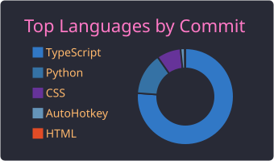
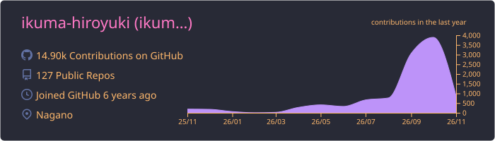

## Hi there 👋

<!-- 🐍 Contribution Snake / 📈 各種カード：.github/workflows/snake.yml が output ブランチへ毎日SVGを再生成（Vercel非依存・レート制限と無縁） -->
<picture>
  <source media="(prefers-color-scheme: dark)" srcset="https://raw.githubusercontent.com/ikuma-hiroyuki/ikuma-hiroyuki/output/github-snake-dark.svg" />
  <source media="(prefers-color-scheme: light)" srcset="https://raw.githubusercontent.com/ikuma-hiroyuki/ikuma-hiroyuki/output/github-snake.svg" />
  
</picture>

 

 

 

 

<!-- 📊 metrics：.github/workflows/metrics.yml が github-metrics.svg を毎日再生成（activity / languages / isocalendar / habits）。要 METRICS_TOKEN シークレット -->

## 制作物

- <a href="https://shift-scheduler-demo.pages.dev" target="_blank" rel="noopener noreferrer">シフト自動作成システム</a>（[リポジトリ](https://github.com/ikuma-hiroyuki/shift-scheduler-demo)） — 小売店向けの月次シフトを Google OR-Tools（CP-SAT）で自動生成する Web アプリ。FastAPI + React。ログイン画面のデモアカウントでそのまま試せます。
- <a href="https://shihou-portfolio-demo.onrender.com" target="_blank" rel="noopener noreferrer">案件管理・受領書作成アプリ</a>（[リポジトリ](https://github.com/ikuma-hiroyuki/shihou-portfolio-demo)） — 司法書士事務所向けの案件進捗・担当割当の可視化と、業務支援ソフトのデータから受領書/報告書を作成するフローを再現した Web アプリ。Next.js + Prisma + PostgreSQL。ログイン不要でそのまま試せます。

## 課外活動

[Udemy講師](https://www.udemy.com/user/yi-jiu-jian-bo-zhi/)
- Python
- AutoHotKey
- Excelピボットテーブル
- Google Appsheet
- VBA
- Windows ショートカットキー

<!-- https://badgen.net/ -->
<!--
**ikuma-hiroyuki/ikuma-hiroyuki** is a ✨ _special_ ✨ repository because its `README.md` (this file) appears on your GitHub profile.

Here are some ideas to get you started:

- 🔭 I’m currently working on ...
- 🌱 I’m currently learning ...
- 👯 I’m looking to collaborate on ...
- 🤔 I’m looking for help with ...
- 💬 Ask me about ...
- 📫 How to reach me: ...
- 😄 Pronouns: ...
- ⚡ Fun fact: ...
-->
